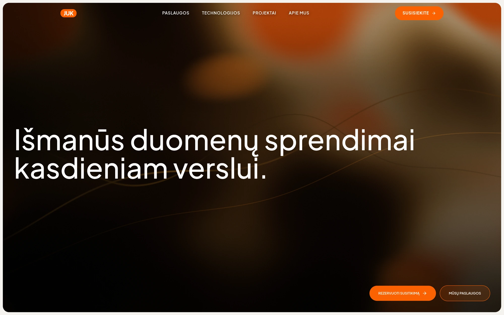

# JUKdata

A fictional Lithuanian data consultancy, presented as a one-page website. The design uses a custom canvas hero, animated section transitions, and a responsive layout.



## Run

Use Node.js 20.9+ and pnpm.

```sh
pnpm install --frozen-lockfile
pnpm dev        # http://localhost:3000
pnpm typecheck
```

Next.js exports static files to `out/`. Preview them with a static server:

```sh
pnpm build
python3 -m http.server 3000 --bind 127.0.0.1 --directory out
```

## Structure

- `app/` — page layout, metadata, consent defaults, and the privacy-policy page.
- `components/` — page sections, canvas animation, and contact form.
- `public/` — logos, images, and the preview screenshot.

The site uses Next.js, React, TypeScript, Tailwind CSS, and Motion. It has no application server or API.

The company, contact details, and privacy-policy page are demo content. The form has no live destination by default. To configure Formspree or Google Tag Manager for a deployment, copy [`.env.example`](.env.example) to `.env.local`. Both settings are public in the built site; don't put secrets there.
